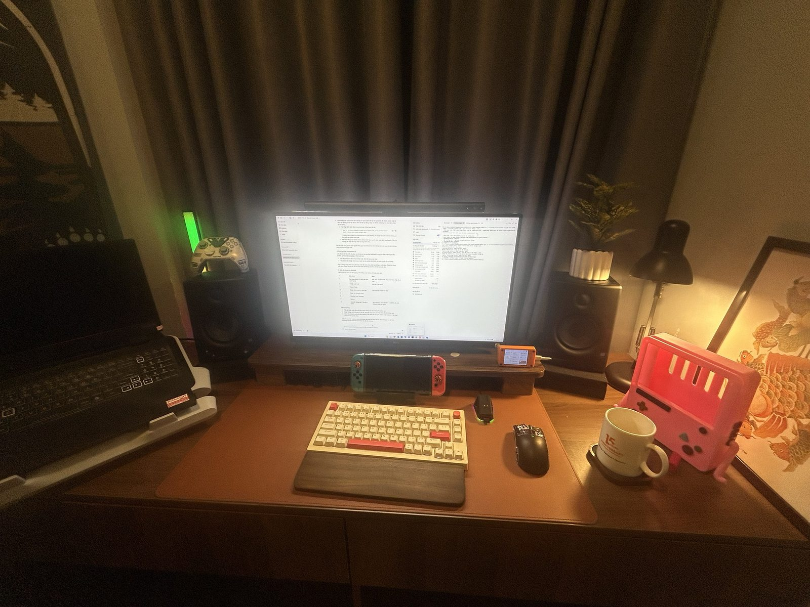
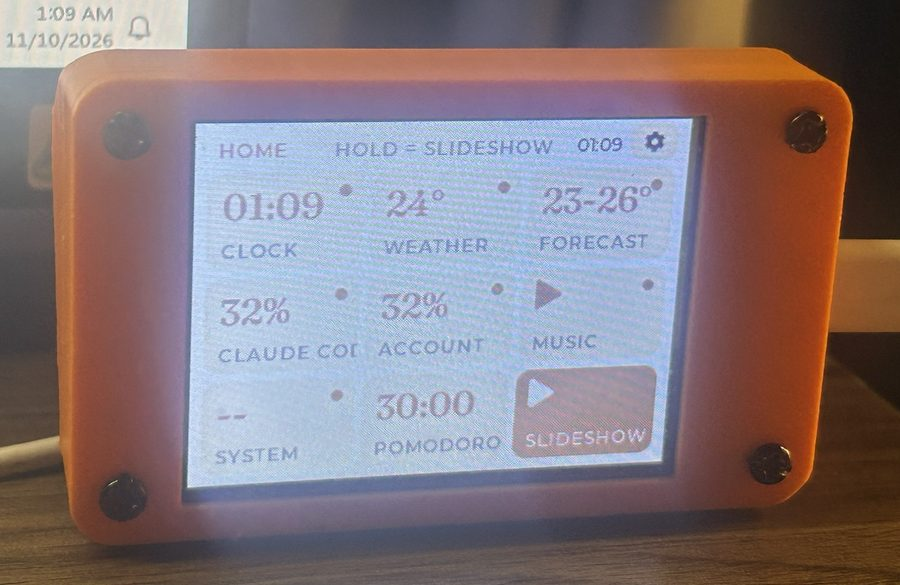
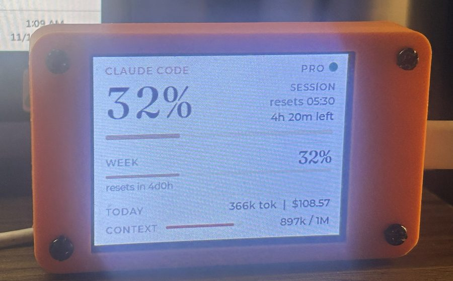
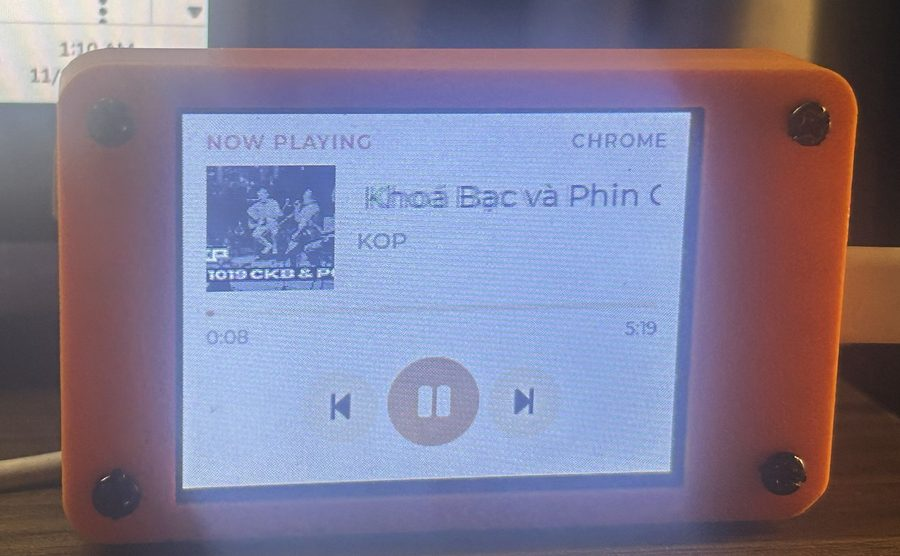
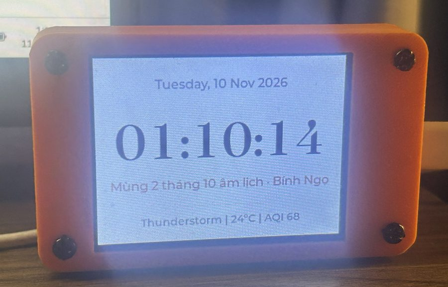
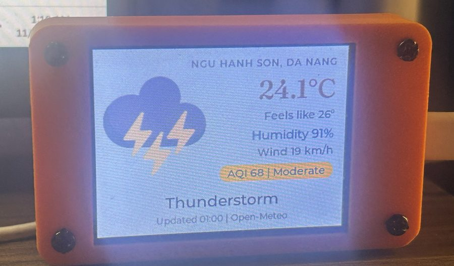
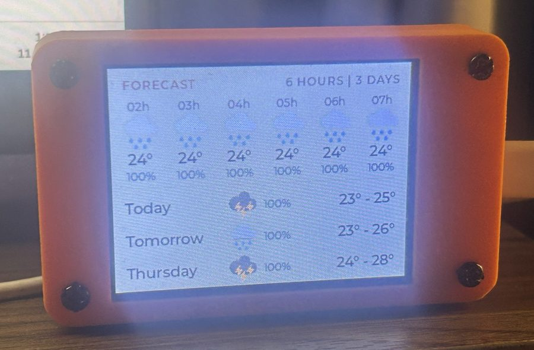
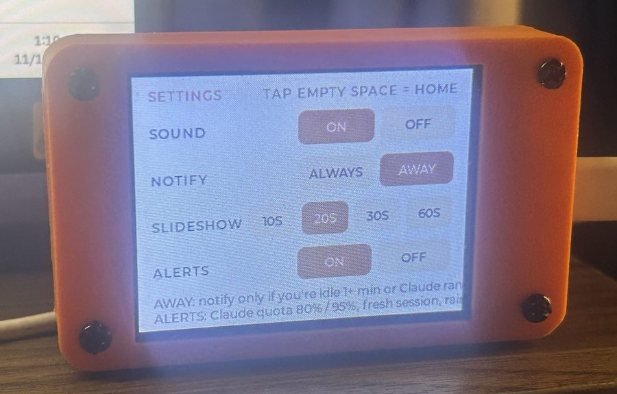
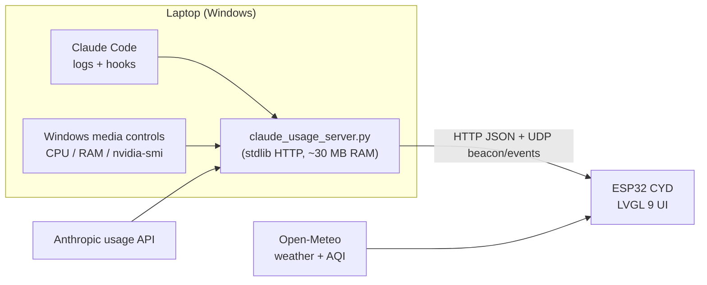

# CYD Desk Dashboard

A desk companion built on the **ESP32 "Cheap Yellow Display"** (ESP32-2432S028R, 2.8" 320×240 touchscreen).
It shows the time with the Vietnamese lunar calendar, live weather and air quality, **Claude Code / Claude account usage**,
what's playing on my PC, PC temperatures, and a Pomodoro timer. A small Python server on the laptop feeds it data.

> 🇻🇳 **Tiếng Việt:** hướng dẫn cài đặt và sử dụng chi tiết ở [README.vi.md](README.vi.md).



## Screenshots

| | |
|---|---|
|  **Home** – launcher with live values |  **Claude Code** – session, week, today, context |
|  **Music** – now playing with album art |  **Clock** – with the Vietnamese lunar date |
|  **Weather** – with US AQI |  **Forecast** – next 6 hours and 3 days |
|  **Settings** – sound, notifications, slideshow, alerts | |

## Features

| Tab | What it shows |
|---|---|
| **Home** | 3×3 launcher with a live value on each tile. Tap a tile to open it, hold to add it to the slideshow |
| **Clock** | Time, date, Vietnamese lunar date with can-chi year (computed on the ESP32), weather summary |
| **Weather / Forecast** | Temperature, feels-like, humidity, wind, US AQI; next 6 hours and 3 days (Open-Meteo) |
| **Claude Code** | 5-hour session %, weekly %, tokens and API-equivalent cost today, context window of the active session |
| **Claude Account** | Account-wide limits plus this week's usage split by app (Claude Code / Chats / Cowork) |
| **Music** | Now playing from any Windows app (Spotify, YouTube in Chrome…), 80×80 album art, prev / play / next |
| **System** | CPU load and temperature, RAM, GPU load and temperature, VRAM |
| **Pomodoro** | Adjustable focus / break lengths, saved across reboots |
| **Settings** | Sound, notification mode, slideshow speed, alerts |

**Notifications** – a Claude Code hook tells the device when Claude finishes or needs permission. In *away* mode it
only alerts when I've been idle for a minute or the task ran for two, so it stays quiet while I'm at the desk.
It also warns at 80% / 95% session usage, when the quota resets, and when rain is likely in the next two hours.

## Architecture



- **Firmware** – Arduino on ESP32, LVGL 9 + TFT_eSPI. Networking runs in its own FreeRTOS task on core 0, so the UI
  never blocks on Wi-Fi; data is handed over under a mutex. Includes a loop watchdog, a network-stall watchdog and a
  low-memory restart for 24/7 use.
- **PC server** – single-file Python (standard library, plus `winrt` for media). Serves `GET /v1/stats` in the
  [claudometer](https://github.com/krizdingus/claudometer) schema, reads exact usage from Anthropic's OAuth usage
  endpoint (falls back to estimates from local logs), and only measures PC sensors while the device shows that tab.
  Measured cost: about 0.015 % CPU and 38 MB RAM in the busiest case.
- **Discovery** – the server broadcasts its address over UDP, so the device follows the laptop when its IP changes.
- **Typography** – Montserrat and Fraunces converted to LVGL bitmap fonts by a small Pillow-based converter
  (`tools/make_lvgl_font.py`), including Vietnamese diacritics.

## Tech

ESP32 · C++ / Arduino · LVGL 9 · FreeRTOS · TFT_eSPI · XPT2046 · ArduinoJson · Python · WinRT · REST / UDP · Open-Meteo

## Repository layout

```
ESP32_tft_clock_weather/   firmware (main sketch, net.ino, ui_build.ino, ui_update.ino, fonts, icons)
pc_server/                 claude_usage_server.py, notify.py (Claude Code hook)
config/                    lv_conf.h and TFT_eSPI User_Setup.h used for this build
tools/                     font converter, image converter, original icons
```

## Build

1. Arduino IDE with ESP32 core 3.x and the libraries `lvgl` 9.x, `TFT_eSPI`, `XPT2046_Touchscreen`, `ArduinoJson` 7.
   Copy `config/lv_conf.h` next to the `lvgl` library and `config/User_Setup.h` into `TFT_eSPI`.
2. Copy `ESP32_tft_clock_weather/secrets.example.h` to `secrets.h` and fill in Wi-Fi and server details.
3. Board **ESP32 Dev Module**, partition scheme **Huge APP (3MB No OTA)**, upload.
4. On the PC: `python pc_server/claude_usage_server.py --plan pro` (details and options in [README.vi.md](README.vi.md)).

The touch calibration in `ui_build.ino` (`TOUCH_RAW_*`) was measured on my panel; re-measure for another board.

## Credits

- Claude usage idea and JSON schema: [claudometer](https://github.com/krizdingus/claudometer) (MIT)
- Fonts: [Montserrat](https://github.com/JulietaUla/Montserrat) and [Fraunces](https://github.com/undercasetype/Fraunces), SIL Open Font License 1.1
- Weather and air quality: [Open-Meteo](https://open-meteo.com/)
- Weather icons: from the Random Nerd Tutorials CYD + LVGL weather station example
- Lunar calendar algorithm: Hồ Ngọc Đức

License: [MIT](LICENSE). Third-party files: [THIRD_PARTY_NOTICES.md](THIRD_PARTY_NOTICES.md).
