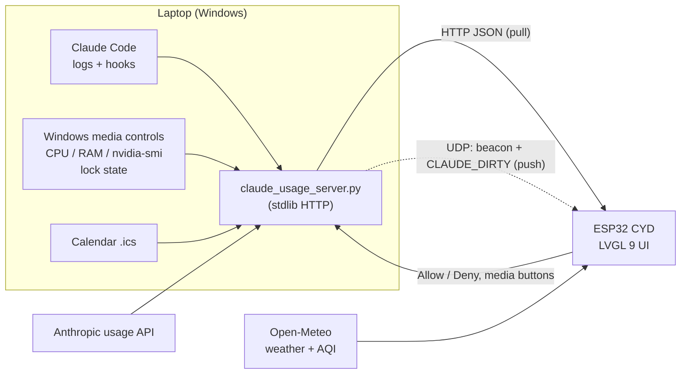

# CYD Desk Dashboard

[](https://github.com/quangdag/cyd-desk-dashboard/actions/workflows/build.yml)

A desk companion built on the **ESP32 "Cheap Yellow Display"** (ESP32-2432S028R, 2.8" 320×240 touchscreen).
It shows the time with the Vietnamese lunar calendar and your next calendar event, live weather and air quality,
**Claude Code / Claude account usage**, what's playing on my PC, PC temperatures, and a Pomodoro timer.
While I'm away from the desk it also lets me **approve or deny Claude Code permission prompts** from the screen.
A small Python server on the laptop feeds it data.

**Try it:** plug a CYD into a computer and open the **[browser installer](https://quangdag.github.io/cyd-desk-dashboard/)**
(Chrome or Edge). No Arduino setup needed.

> 🇻🇳 **Tiếng Việt:** hướng dẫn cài đặt và sử dụng chi tiết ở [README.vi.md](README.vi.md).


## Screenshots

| | | |
|---|---|---|
|  **Home** – launcher with live values |  **Clock** – lunar date, next event |  **Weather** – with US AQI |
|  **Claude Code** – session, week, today, context |  **Account** – usage by app |  **Music** – now playing |
|  **System** – CPU / GPU load and temps |  **Settings** |  **Device** – health numbers |

*Pixel-exact captures read back from the panel over USB with [`tools/cyd_capture.py`](tools/cyd_capture.py).*

## Features

| Tab | What it shows |
|---|---|
| **Home** | 3×3 launcher with a live value on each tile. Tap a tile to open it, hold to add it to the slideshow |
| **Clock** | Time, date, Vietnamese lunar date with can-chi year (computed on the ESP32), next calendar event, weather summary |
| **Weather / Forecast** | Temperature, feels-like, humidity, wind, US AQI; next 6 hours and 3 days (Open-Meteo) |
| **Claude Code** | 5-hour session %, weekly %, tokens and API-equivalent cost today, context window of the active session |
| **Claude Account** | Account-wide limits plus this week's usage split by app (Claude Code / Chats / Cowork) |
| **Music** | Now playing from any Windows app (Spotify, YouTube or Facebook in Chrome…), 80×80 rounded album art, prev / play / next; Vietnamese and Thai titles |
| **System** | CPU load and temperature, RAM, GPU load and temperature, VRAM |
| **Pomodoro** | Adjustable focus / break lengths, saved across reboots |
| **Settings** | Sound, notification mode, slideshow speed, alerts, screen mode (always on / off while the PC is locked or asleep) |
| **Device** | Frame render time, free and lowest RAM, Wi-Fi signal and drops, server and weather API latency, uptime |

**Notifications** – a Claude Code hook tells the device when Claude finishes or needs permission. In *away* mode it
only alerts when I've been idle for a minute or the task ran for two, so it stays quiet while I'm at the desk.
It also warns at 80% / 95% session usage, when the quota resets, and when rain is likely in the next two hours.

**Approve from the desk** – a `PermissionRequest` hook routes Claude Code's permission prompts to the CYD when I've
been away from the keyboard for a minute. The card shows the project, tool and command with **Deny** / **Allow** and a
90-second countdown. No answer, or coming back to the PC, falls back to the normal prompt; the CYD can only answer,
never decide on its own, and Claude Code's deny rules still apply.


Measured end to end: request from the hook → UDP push → card on the CYD within about 2 s; the answer reaches the waiting
hook as soon as it's tapped.

**Setup without code** – a fresh board starts a `CYD-Setup` Wi-Fi access point with a captive portal: join it from a
phone, enter Wi-Fi, server token and location, done. Settings live in NVS; `secrets.h` is optional.

## Architecture



- **Firmware** – Arduino on ESP32, LVGL 9 + TFT_eSPI. Networking runs in its own FreeRTOS task on core 0, so the UI
  never blocks on Wi-Fi; data is handed over under a mutex. Loop watchdog, network-stall watchdog and a low-memory
  restart for 24/7 use. A captive portal (`WebServer` + `DNSServer`) handles first-time setup.
- **Push, then pull** – the server watches what the CYD is showing (track and play state while the Music page is open,
  exact usage %, pending permission requests) and sends a one-word UDP datagram to the CYD when something changes; the
  CYD then fetches `GET /v1/stats`. Polling only remains as a safety net (10–60 s instead of 2–5 s).
- **PC server** – single-file Python (standard library, plus `winrt` for media). Serves the
  [claudometer](https://github.com/krizdingus/claudometer) schema plus permission, calendar and lock-state fields,
  reads exact usage from Anthropic's OAuth usage endpoint (falls back to estimates from local logs) and lets the
  official Claude CLI renew its login. `ensure_server.py` starts it at login and whenever Claude Code starts, and does
  nothing if it is already running. Measured cost: about 0.015 % CPU and 38 MB RAM in the busiest case.
- **Discovery** – the server broadcasts its address over UDP, so the device follows the laptop when its IP changes.
- **Typography** – Montserrat and Fraunces converted to LVGL bitmap fonts by a small Pillow-based converter
  (`tools/make_lvgl_font.py`), including Vietnamese diacritics. Song titles fall back to Noto Sans Thai for Thai
  script; LVGL does no Thai shaping, so the server swaps in raised tone marks where they would hit an upper vowel.

## Engineering notes

- **lwIP race in ESP32 core 3.x** – SNTP resolving `pool.ntp.org` at the same moment as an `HTTPClient` DNS lookup
  trips `sys_untimeout … Required to lock TCPIP core` and reboots the board. The firmware resolves the NTP servers
  itself and hands SNTP plain IP addresses, so SNTP never touches DNS.
- **Panel readback** – the screenshot tool reads the ILI9341 GRAM back over SPI. This panel returns the bytes as
  blue, red, green, so the tool remaps the fields (worked out by comparing against the known UI palette).
- **Memory: the heap number that lied** – `ESP.getFreeHeap()` reported ~48 KB free, but it counts ~36 KB of IRAM
  that only allows 32-bit access, which `malloc()` for LVGL, Wi-Fi and `String` can't use. The real figure
  (`heap_caps_get_free_size(MALLOC_CAP_8BIT)`) was 12 KB, dipping to 1.7 KB, and in Wi-Fi setup mode 3.6 KB: LVGL failed
  to allocate a glyph buffer, its assert spun forever and the loop watchdog rebooted the board, which looked like lag,
  a frozen screen and a setup page that never loaded. The pages were the biggest user (81 KB for ~240 widgets). The fix:
  - shared `lv_style_t` objects instead of per-widget local styles, and constant label text that isn't copied;
  - Settings and Device are built when opened and freed when you leave them;
  - the album-art buffers (25 KB) are allocated only while the Music page is in use;
  - setup mode builds only its own screen and runs the access point alone;
  - JSON is parsed straight from the socket.

  Result: 52 KB free with a 37 KB low point in normal use, and 108 KB in setup mode, with every page pixel-identical
  (checked with the screenshot tool). The draw buffer stays at ¼ screen: the `BENCH` serial command measured a full
  redraw at 55 ms with it and 76 ms at ⅛. `STATS` and the Device page now report the real figure.

## Tech

ESP32 · C++ / Arduino · LVGL 9 · FreeRTOS · TFT_eSPI · XPT2046 · ArduinoJson · captive portal · Python · WinRT ·
REST / UDP · iCalendar · Open-Meteo · GitHub Actions · ESP Web Tools

## Repository layout

```
ESP32_tft_clock_weather/   firmware (main sketch, net.ino, setup_portal.ino, ui_build.ino, ui_update.ino, fonts, icons)
pc_server/                 claude_usage_server.py, ensure_server.py (autostart), notify.py and permission.py
                           (Claude Code hooks), tests/
config/                    lv_conf.h and TFT_eSPI User_Setup.h used for this build
web/                       browser installer (GitHub Pages, ESP Web Tools)
.github/workflows/         build + tests on every push; release + Pages on v* tags
tools/                     font converter, image converter, USB screenshot tool
```

## Build

1. Arduino IDE / arduino-cli with ESP32 core 3.3.x and the libraries `lvgl` 9.5.0, `TFT_eSPI` 2.5.43,
   `XPT2046_Touchscreen` 1.4, `ArduinoJson` 7.4.3 (the versions CI builds with).
   Copy `config/lv_conf.h` next to the `lvgl` library and `config/User_Setup.h` into `TFT_eSPI`.
2. Board **ESP32 Dev Module**, partition scheme **Huge APP (3MB No OTA)**, upload. Wi-Fi is entered on the device;
   `secrets.example.h` → `secrets.h` is only needed to bake in defaults.
3. On the PC: `python pc_server/claude_usage_server.py --plan pro`. The first start writes the CYD token to
   `pc_server/token.txt`. Hooks, autostart and the optional calendar (`pc_server/calendar.txt`) are described in
   [README.vi.md](README.vi.md).
4. Tests: `python -m unittest discover -s pc_server/tests`.

The touch calibration in `ui_build.ino` (`TOUCH_RAW_*`) was measured on my panel; re-measure for another board.

## Credits

- Claude usage idea and JSON schema: [claudometer](https://github.com/krizdingus/claudometer) (MIT)
- Fonts: [Montserrat](https://github.com/JulietaUla/Montserrat), [Fraunces](https://github.com/undercasetype/Fraunces) and [Noto Sans Thai](https://github.com/notofonts/thai), SIL Open Font License 1.1
- Weather and air quality: [Open-Meteo](https://open-meteo.com/)
- Browser flashing: [ESP Web Tools](https://esphome.github.io/esp-web-tools/) (Apache 2.0)
- Weather icons: from the Random Nerd Tutorials CYD + LVGL weather station example
- Lunar calendar algorithm: Hồ Ngọc Đức

License: [MIT](LICENSE). Third-party files: [THIRD_PARTY_NOTICES.md](THIRD_PARTY_NOTICES.md).
