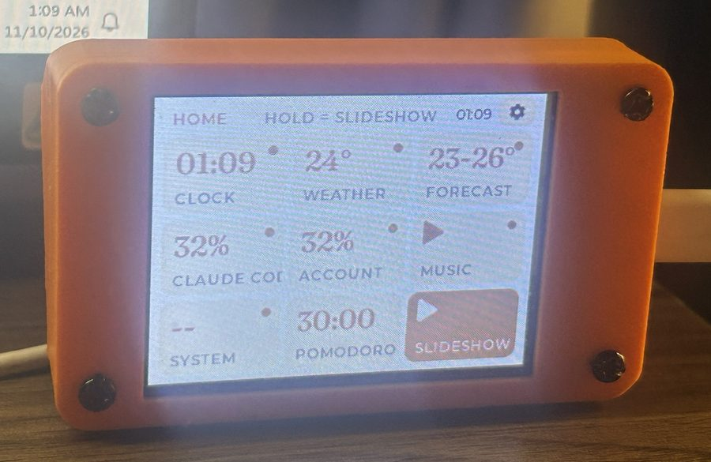
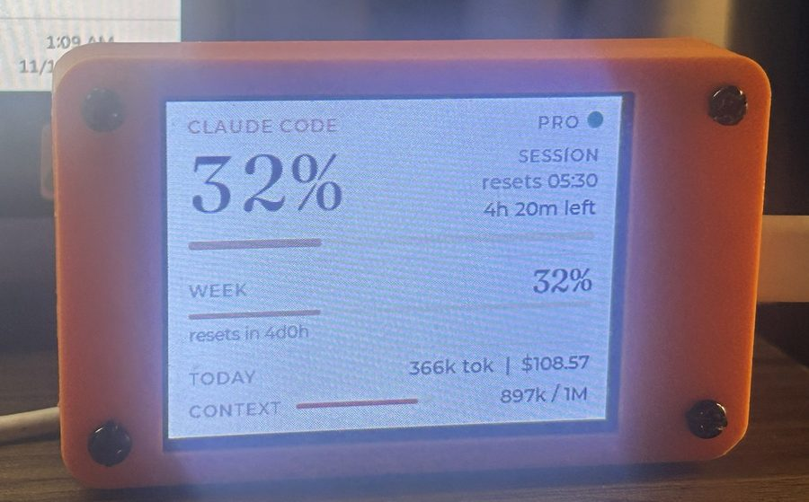
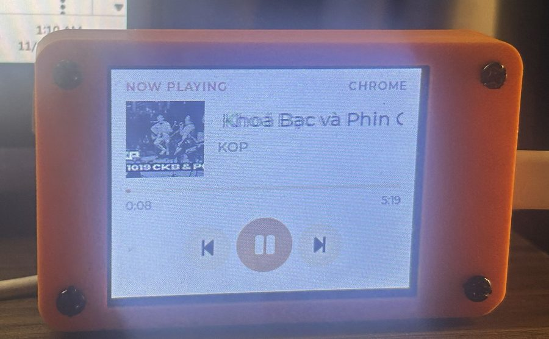
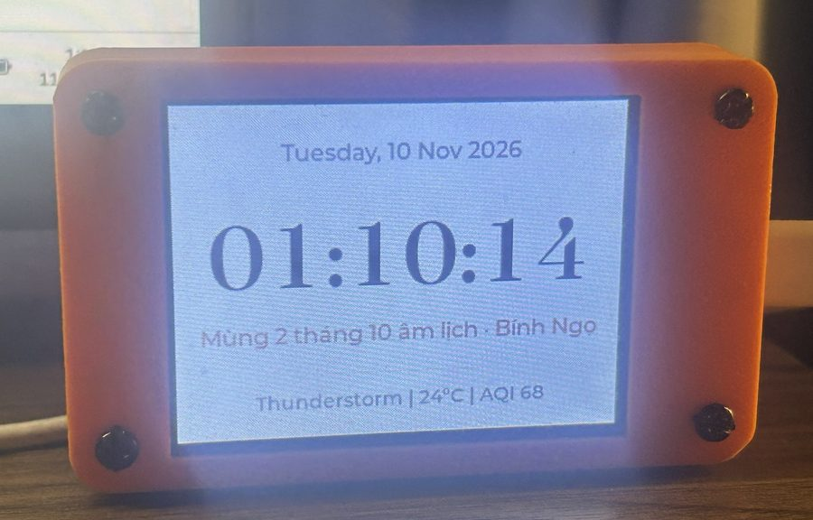
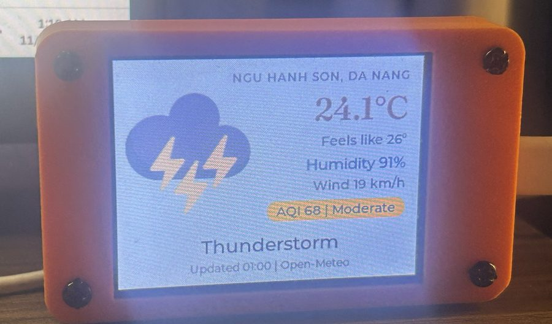
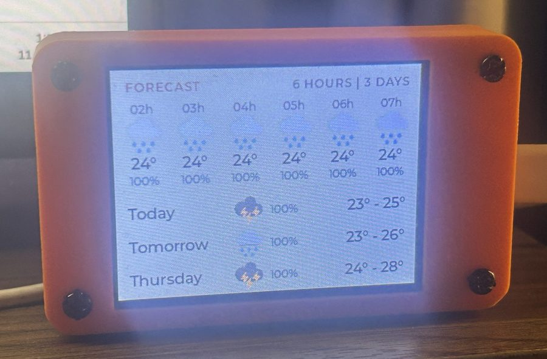

# CYD Desk Dashboard (Tiếng Việt)

Màn hình để bàn làm từ **ESP32 "Cheap Yellow Display"** (CYD, mã ESP32-2432S028R, màn cảm ứng 2,8 inch 320×240).
Thiết bị hiện đồng hồ kèm **âm lịch**, thời tiết và chất lượng không khí, **mức dùng Claude Code / tài khoản Claude**,
bài hát đang phát trên máy tính, nhiệt độ CPU/GPU và đồng hồ Pomodoro. Một server Python nhỏ chạy trên laptop
cung cấp dữ liệu cho CYD qua WiFi.

*English: [README.md](README.md)*


| | |
|---|---|
|  |  |
|  |  |
|  |  |

**Mục lục:** [Tính năng](#tính-năng) · [Cần chuẩn bị](#cần-chuẩn-bị) · [Cài đặt CYD](#phần-1--cài-đặt-cyd) ·
[Cài server trên máy tính](#phần-2--cài-server-trên-máy-tính) · [Hướng dẫn sử dụng](#hướng-dẫn-sử-dụng) ·
[Xử lý sự cố](#xử-lý-sự-cố)

---

## Tính năng

| Tab | Nội dung |
|---|---|
| **Home** | Lưới 9 ô, mỗi ô hiện một con số xem nhanh. Chạm để mở tab, giữ để thêm vào slideshow |
| **Clock** | Giờ, thứ, ngày; dòng âm lịch tiếng Việt kèm can chi (tính ngay trên ESP32); tóm tắt thời tiết |
| **Weather** | Nhiệt độ, cảm giác như, độ ẩm, gió, chỉ số AQI có màu theo mức độ |
| **Forecast** | 6 giờ tới và 3 ngày tới, kèm khả năng mưa |
| **Claude Code** | % phiên 5 giờ, % tuần, token và chi phí quy đổi hôm nay, độ đầy ngữ cảnh của phiên đang chạy |
| **Account** | Hạn mức chung của cả tài khoản Claude, kèm tỷ lệ dùng trong tuần theo Claude Code / Chats / Cowork |
| **Music** | Bài đang phát (Spotify, YouTube trên Chrome/Edge…), ảnh bìa, nút lùi / phát / tới |
| **System** | Tải và nhiệt độ CPU, RAM, tải và nhiệt độ GPU, VRAM |
| **Pomodoro** | Đếm giờ tập trung / nghỉ, nút − / + để chỉnh thời lượng mỗi lần 5 phút |
| **Settings** | Âm thanh, chế độ thông báo, tốc độ slideshow, bật/tắt cảnh báo |

**Thông báo:** khi Claude Code làm xong việc hoặc cần bạn cấp quyền, CYD hiện thẻ thông báo và kêu bíp.
CYD cũng cảnh báo khi phiên Claude dùng tới 80% / 95%, khi hạn mức được làm mới, và khi 1–2 giờ tới khả năng mưa cao.

> Tab **Claude Code**, **Account**, **Music** và **System** cần server trên máy tính (Phần 2).
> Không cài server thì Clock, Weather, Forecast và Pomodoro vẫn chạy bình thường.

---

## Cần chuẩn bị

**Phần cứng**
- Bo **ESP32-2432S028R** (CYD 2,8 inch, bản 1 cổng hoặc 2 cổng USB đều được).
- Cáp USB **có truyền dữ liệu**. Cáp chỉ để sạc sẽ không nạp được code.
- *(Tuỳ chọn)* Loa nhỏ 8 Ω gắn vào cổng **SPEAK** trên bo để nghe tiếng bíp.
- *(Tuỳ chọn)* Vỏ in 3D.

**Phần mềm**
- [Arduino IDE](https://www.arduino.cc/en/software) 2.x.
- [Python](https://www.python.org/downloads/) 3.9 trở lên (cho server). Khi cài, nhớ tick **"Add python.exe to PATH"**.
- Windows 10/11 nếu muốn dùng tab Music và System. Phần Claude chạy được cả trên macOS/Linux.
- *(Tuỳ chọn)* [Claude Code](https://claude.com/claude-code) nếu muốn theo dõi mức dùng Claude.

**Tải mã nguồn:** bấm **Code → Download ZIP** trên trang GitHub rồi giải nén, hoặc:

```bash
git clone https://github.com/quangdag/cyd-desk-dashboard.git
```

---

## Phần 1 – Cài đặt CYD

### Bước 1. Cài board ESP32 cho Arduino IDE
1. Mở **File → Preferences**. Ở ô *Additional boards manager URLs* dán:
   `https://raw.githubusercontent.com/espressif/arduino-esp32/gh-pages/package_esp32_index.json`
2. Mở **Tools → Board → Boards Manager**, tìm **esp32** (của Espressif), cài bản **3.x**.

### Bước 2. Cài thư viện
Mở **Tools → Manage Libraries**, tìm và cài:

| Thư viện | Phiên bản |
|---|---|
| `lvgl` | 9.x |
| `TFT_eSPI` (Bodmer) | mới nhất |
| `XPT2046_Touchscreen` (Paul Stoffregen) | mới nhất |
| `ArduinoJson` (Benoit Blanchon) | 7.x |

### Bước 3. Chép 2 file cấu hình thư viện
Hai thư viện màn hình cần cấu hình riêng cho CYD. Bản dùng cho dự án này nằm trong thư mục `config/`.

1. Tìm thư mục thư viện: **File → Preferences → Sketchbook location**, rồi mở thư mục con `libraries`
   (thường là `Documents\Arduino\libraries`).
2. Chép **`config/lv_conf.h`** vào thư mục `libraries` (nằm **cạnh** thư mục `lvgl`, không phải bên trong).
3. Chép **`config/User_Setup.h`** vào `libraries\TFT_eSPI\`, **ghi đè** file cũ. Nên lưu bản cũ phòng khi cần.

> Hai thiết lập quan trọng trong `lv_conf.h`: `LV_USE_STDLIB_MALLOC` = `LV_STDLIB_CLIB` (LVGL dùng bộ nhớ chung
> của ESP32; bộ nhớ mặc định 36 KB không đủ cho 10 trang) và `LV_FONT_MONTSERRAT_12/14/16/20/24` = `1`.

### Bước 4. Điền WiFi và thông tin server
1. Trong thư mục `ESP32_tft_clock_weather`, chép **`secrets.example.h`** thành **`secrets.h`**.
2. Mở `secrets.h` và điền:

```cpp
static const char WIFI_SSID[]     = "Ten-WiFi-nha-ban";      // chỉ WiFi 2,4 GHz
static const char WIFI_PASSWORD[] = "mat-khau-wifi";

#define CLAUDE_ENABLED 1                            // 0 = không dùng server, ẩn các tab cần server
static const char CLAUDE_HOST[]  = "192.168.1.100"; // IP máy tính chạy server (xem Phần 2, bước 4)
static const uint16_t CLAUDE_PORT = 7842;
static const char CLAUDE_TOKEN[] = "doi-thanh-chuoi-bi-mat"; // chuỗi ngẫu nhiên bất kỳ
```

- `CLAUDE_TOKEN` là "mật khẩu" giữa CYD và server. Đặt chuỗi gì cũng được, server tự đọc lại từ file này.
- Lấy IP máy tính: mở PowerShell, gõ `ipconfig`, tìm dòng **IPv4 Address** của card WiFi.
  Sau này nếu IP đổi, CYD tự tìm lại server, nên không cần sửa.
- `secrets.h` đã có trong `.gitignore`, sẽ không bị đẩy lên GitHub.

### Bước 5. Chỉnh vị trí và múi giờ (nếu không ở Đà Nẵng)
Đầu file `ESP32_tft_clock_weather.ino`:

```cpp
const char* TIMEZONE  = "ICT-7";      // giờ Việt Nam
const char* LATITUDE  = "16.0044";    // vĩ độ nơi bạn ở
const char* LONGITUDE = "108.2632";   // kinh độ nơi bạn ở
```

Tên địa điểm trên tab Weather sửa ở `ui_build.ino` (dòng `"NGU HANH SON, DA NANG"`).
Tên máy trên tab System sửa ở dòng `"ACER NITRO 5"`. Lấy toạ độ: mở Google Maps, chuột phải vào vị trí, bấm vào cặp số.

### Bước 6. Nạp code
1. Cắm CYD vào máy tính. Nếu không thấy cổng COM, cài driver **CH340**.
2. Mở `ESP32_tft_clock_weather/ESP32_tft_clock_weather.ino` (Arduino IDE tự mở thêm các tab `net`, `ui_build`, `ui_update`).
3. Chọn trong menu **Tools**:
   - **Board:** ESP32 Dev Module
   - **Partition Scheme:** **Huge APP (3MB No OTA/1MB SPIFFS)**. **Bắt buộc** chọn, vì firmware khoảng 1,9 MB, lớn hơn phân vùng mặc định.
   - **Port:** cổng COM của CYD
4. Bấm **Upload** (mũi tên →). Nếu dừng ở `Connecting.....`, **giữ nút BOOT** trên bo tới khi thấy `Writing...`.

Sau khi nạp, CYD hiện màn HOME. Thời tiết có sau vài giây khi WiFi đã kết nối.

---

## Phần 2 – Cài server trên máy tính

Server là một file Python, chạy ngầm, rất nhẹ (khoảng 30 MB RAM và gần 0% CPU, không dùng GPU).

### Bước 1. Cài thư viện Python

```bash
pip install pillow winrt-runtime winrt-Windows.Media.Control winrt-Windows.Foundation winrt-Windows.Storage.Streams
```

Các thư viện này chỉ dùng cho tab **Music** (đọc bài hát, ảnh bìa). Phần còn lại của server chỉ dùng thư viện có sẵn của Python.

### Bước 2. Chạy thử
Mở terminal ở thư mục dự án:

```bash
python pc_server/claude_usage_server.py --plan pro
```

- `--plan` là gói Claude của bạn: `free`, `pro`, `max-5x` hoặc `max-20x`.
- Lần đầu chạy, Windows hỏi quyền tường lửa: tick **Private networks** rồi bấm **Allow**.
- Thấy dòng `Listening on 0.0.0.0:7842` là server đã chạy. Mở tab Claude Code trên CYD, chấm tròn góc phải
  chuyển **xanh lá** (số chính xác) hoặc **vàng** (số ước tính).

### Bước 3. Lấy số % chính xác từ Anthropic (khuyên dùng)
Không làm bước này thì server **ước tính** % từ log của Claude Code, có thể lệch vài phần trăm so với claude.ai.

1. Cài Claude Code CLI. Trên Windows, mở PowerShell và chạy:
   `irm https://claude.ai/install.ps1 | iex`
2. Đăng nhập một lần: `claude auth login`, chọn tài khoản Claude của bạn.

Từ đó server lấy % và giờ đặt lại từ chính nguồn mà lệnh `/usage` của Claude Code dùng. Token đăng nhập chỉ gửi tới Anthropic.

### Bước 4. Bật thông báo khi Claude Code xong việc
Mở (hoặc tạo) file `C:\Users\<tên-bạn>\.claude\settings.json`, thêm mục `hooks` như dưới.
Sửa đường dẫn cho đúng máy bạn; trong JSON phải viết `\\` thay cho `\`.

```json
{
  "hooks": {
    "Stop": [{ "hooks": [{ "type": "command", "async": true, "timeout": 5,
      "command": "C:\\Users\\<tên-bạn>\\AppData\\Local\\Programs\\Python\\Python311\\python.exe",
      "args": ["-I", "D:\\duong-dan\\cyd-desk-dashboard\\pc_server\\notify.py", "stop"] }] }],
    "Notification": [{ "hooks": [{ "type": "command", "async": true, "timeout": 5,
      "command": "C:\\Users\\<tên-bạn>\\AppData\\Local\\Programs\\Python\\Python311\\python.exe",
      "args": ["-I", "D:\\duong-dan\\cyd-desk-dashboard\\pc_server\\notify.py", "notification"] }] }]
  }
}
```

Nếu file đã có sẵn nội dung khác, chỉ thêm phần `"hooks"` vào, đừng xoá phần cũ. Mở phiên Claude Code mới để hook có hiệu lực.

### Bước 5. Cho server tự chạy khi bật máy
1. Bấm **Win + R**, gõ `shell:startup`, Enter. Thư mục Startup sẽ mở ra.
2. Chuột phải → **New → Shortcut**, dán (sửa đường dẫn cho đúng máy bạn):

   ```
   "C:\Users\<tên-bạn>\AppData\Local\Programs\Python\Python311\pythonw.exe" "D:\duong-dan\cyd-desk-dashboard\pc_server\claude_usage_server.py" --plan pro --log "D:\duong-dan\cyd-desk-dashboard\pc_server\server.log"
   ```
3. Đặt tên shortcut, ví dụ "CYD server".

`pythonw.exe` chạy ngầm, không hiện cửa sổ. Nhật ký nằm trong `server.log`. Muốn tắt tự chạy thì xoá shortcut đó.

### Tuỳ chọn khác của server

| Tham số | Tác dụng |
|---|---|
| `--plan pro` | Gói Claude (dùng khi tính % ước tính) |
| `--reset-weekday 5 --reset-hour 2` | Giờ đặt lại hạn mức tuần cho chế độ ước tính (0 = thứ Hai … 6 = Chủ nhật). Xem giờ đúng ở trang usage của claude.ai |
| `--calibrate 16 17` | Chỉnh % ước tính cho khớp claude.ai: truyền vào % phiên và % tuần claude.ai đang hiện |
| `--no-exact` | Không hỏi Anthropic, chỉ ước tính từ log |
| `--print` | In một lần dữ liệu JSON rồi thoát, để kiểm tra |
| `--log server.log` | Ghi nhật ký ra file (dùng khi chạy ngầm) |
| `--port 7842` | Đổi cổng (nhớ sửa `CLAUDE_PORT` trong `secrets.h`) |

---

## Hướng dẫn sử dụng

### Điều khiển

| Thao tác | Kết quả |
|---|---|
| **Chạm một ô** trên HOME | Mở tab đó. Tab đứng yên, không tự chuyển |
| **Chạm chỗ trống** trong tab | Quay về HOME |
| **Chạm ô SLIDESHOW** (ô màu cam) | Các tab đã chọn tự chuyển lần lượt |
| **Giữ một ô** (~1 giây), hoặc giữ ngay trong tab | Thêm tab vào slideshow, hoặc bớt ra. Ô có **chấm cam** là đang trong slideshow |
| **Nút ⚙** góc phải trên HOME | Mở Settings |
| **Chạm thẻ thông báo** | Đóng thẻ (thẻ tự ẩn sau 25 giây) |

CYD nhớ chế độ và tab đang mở; rút điện cắm lại vẫn quay về đúng chỗ.

### Settings

| Mục | Lựa chọn |
|---|---|
| **SOUND** | Bật/tắt tiếng bíp (cần gắn loa) |
| **NOTIFY** | **ALWAYS:** lần nào Claude xong việc cũng báo. **AWAY:** chỉ báo khi bạn rời chuột/bàn phím từ 1 phút trở lên, hoặc khi Claude chạy từ 2 phút trở lên. Báo "cần cấp quyền" thì luôn hiện |
| **SLIDESHOW** | Mỗi tab hiện 10 / 20 / 30 / 60 giây |
| **ALERTS** | Cảnh báo phiên Claude 80% / 95%, tuần 80%, hạn mức mới, mưa sắp tới |

### Ý nghĩa chấm tròn trên tab Claude
- 🟢 **Xanh lá:** số chính xác từ Anthropic.
- 🟡 **Vàng:** số ước tính từ log (chưa `claude auth login`, hoặc tạm thời không lấy được).
- 🔴 **Đỏ:** mất kết nối với server. CYD vẫn giữ số cũ để bạn xem.

### Tab Pomodoro
Bấm **−** / **+** để chỉnh thời lượng pha đang hiện (Focus / Short break / Long break), rồi bấm **Start**.
Khi hết giờ, CYD báo, kêu bíp và tự chuyển sang tab Pomodoro. Sau 4 phiên tập trung sẽ có một lần nghỉ dài.

---

## Xử lý sự cố

| Hiện tượng | Cách xử lý |
|---|---|
| Upload báo `Sketch too big` | Chưa chọn **Partition Scheme → Huge APP** |
| Upload đứng ở `Connecting.....` | Giữ nút **BOOT** trên bo khi đang nạp |
| Không thấy cổng COM | Thay cáp USB có truyền dữ liệu; cài driver CH340 |
| Màn trắng hoặc màu bị ngược | Chưa chép `config/User_Setup.h` vào `TFT_eSPI` |
| Lỗi biên dịch về `lv_conf.h` hoặc thiếu font | Chưa chép `config/lv_conf.h` cạnh thư mục `lvgl` |
| Không có giờ, không có thời tiết | Kiểm tra tên/mật khẩu WiFi; CYD chỉ bắt WiFi **2,4 GHz** |
| Tab Claude báo **PC OFFLINE** | Server chưa chạy; tường lửa đang chặn (cho phép Private network); máy tính và CYD phải cùng mạng WiFi |
| Chấm **vàng** mãi không xanh | Chạy `claude auth login`; nếu `server.log` có `HTTP 429` thì chờ vài phút, server tự thử lại |
| Tab Music báo *Media reader unavailable* | Chưa cài các gói `winrt-...` ở Phần 2, bước 1 |
| Không hiện thông báo khi Claude xong | Kiểm tra mục `hooks` trong `settings.json` rồi mở phiên Claude Code mới; Settings đang ở **AWAY** và bạn đang ngồi ở máy (chuyển sang **ALWAYS** để thử) |
| Chạm bị lệch, bấm nút không trúng | Thông số cảm ứng (`TOUCH_RAW_*` trong `ui_build.ino`) được đo cho một tấm cụ thể; tấm khác cần đo lại 4 góc |

---

## Cấu trúc thư mục

```
ESP32_tft_clock_weather/   firmware: file chính, net.ino (mạng), ui_build.ino (giao diện), ui_update.ino (cập nhật), font, icon
pc_server/                 claude_usage_server.py (server), notify.py (hook Claude Code)
config/                    lv_conf.h và User_Setup.h dùng cho bản build này
docs/images/               ảnh chụp cho README
tools/                     công cụ tạo font, đổi định dạng ảnh, icon gốc
```

## Ghi công

- Ý tưởng và cấu trúc dữ liệu mức dùng Claude: [claudometer](https://github.com/krizdingus/claudometer) (MIT)
- Font [Montserrat](https://github.com/JulietaUla/Montserrat) và [Fraunces](https://github.com/undercasetype/Fraunces), giấy phép SIL OFL 1.1
- Thời tiết và chất lượng không khí: [Open-Meteo](https://open-meteo.com/)
- Icon thời tiết: từ bài hướng dẫn CYD + LVGL weather station của Random Nerd Tutorials
- Thuật toán âm lịch: Hồ Ngọc Đức

Giấy phép: [MIT](LICENSE). Các file của bên thứ ba: [THIRD_PARTY_NOTICES.md](THIRD_PARTY_NOTICES.md).
