# CYD Desk Dashboard (Tiếng Việt)

[](https://github.com/quangdag/cyd-desk-dashboard/actions/workflows/build.yml)

Màn hình để bàn làm từ **ESP32 "Cheap Yellow Display"** (CYD, mã ESP32-2432S028R, màn cảm ứng 2,8 inch 320×240).
Thiết bị hiện đồng hồ kèm **âm lịch** và **lịch hẹn sắp tới**, thời tiết và chất lượng không khí,
**mức dùng Claude Code / tài khoản Claude**, bài hát đang phát trên máy tính, nhiệt độ CPU/GPU và đồng hồ Pomodoro.
Khi bạn vắng mặt, CYD còn cho bạn **duyệt yêu cầu cấp quyền của Claude Code** ngay trên màn hình.
Một server Python nhỏ chạy trên laptop cung cấp dữ liệu cho CYD qua WiFi.

*English: [README.md](README.md)*

**Cài nhanh nhất:** cắm CYD vào máy tính, mở **[trang cài đặt trên trình duyệt](https://quangdag.github.io/cyd-desk-dashboard/)**
(Chrome hoặc Edge), bấm *Install*. Không cần cài Arduino.

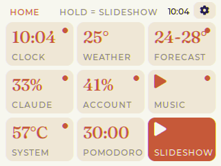

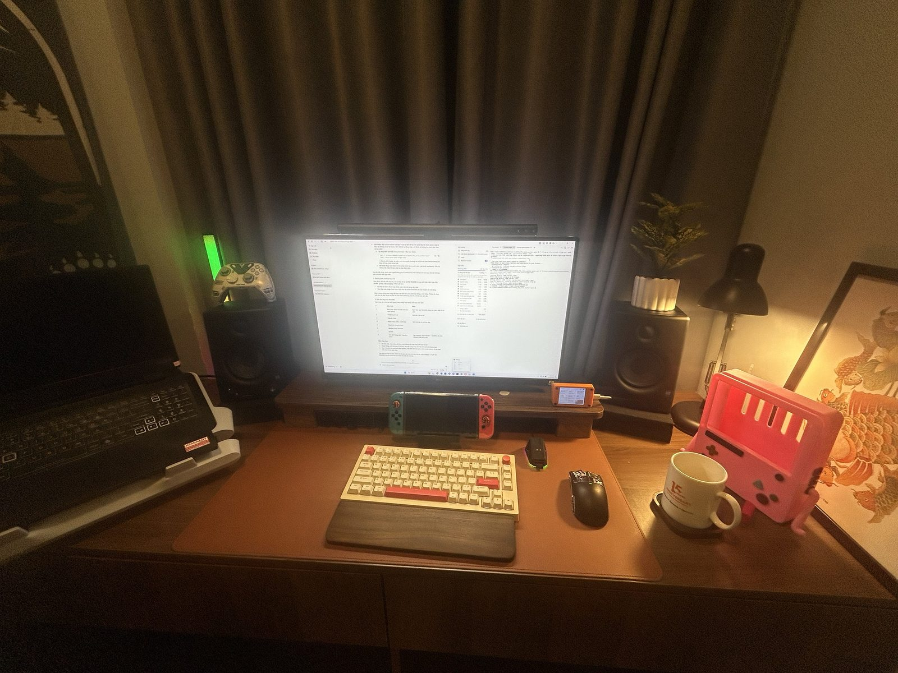

| | | |
|---|---|---|
|  | 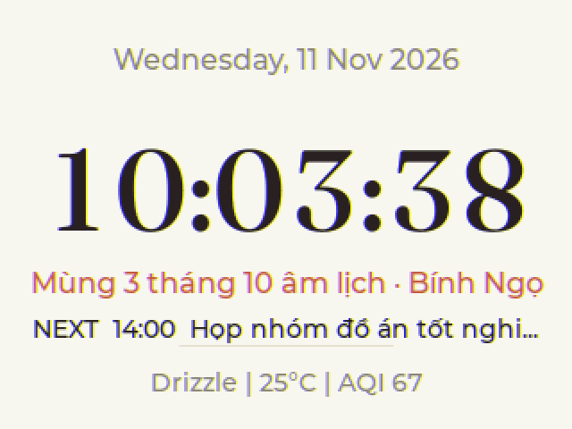 | 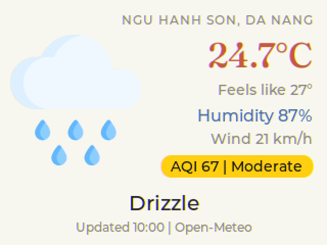 |
| 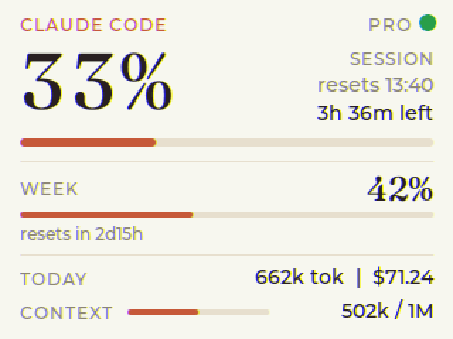 | 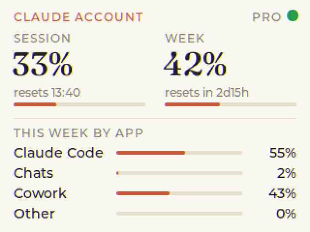 | 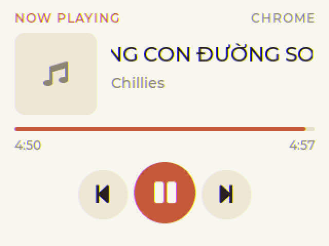 |
| 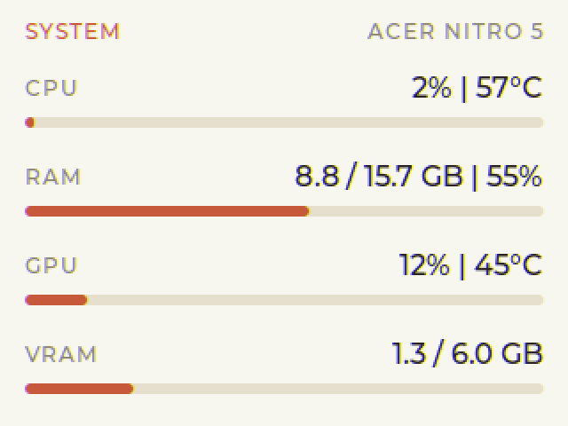 | 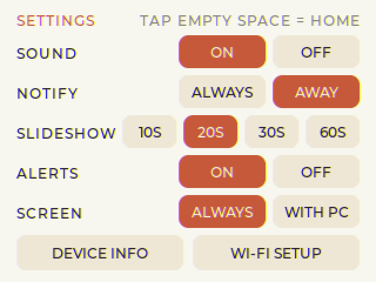 | 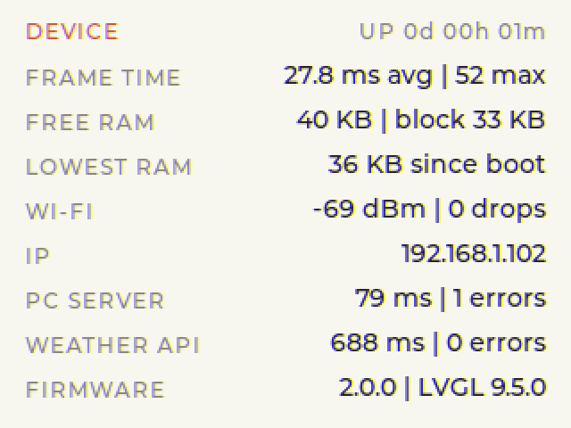 |

*Ảnh chụp thẳng từ màn hình CYD qua cáp USB bằng `tools/cyd_capture.py`.*

**Mục lục:** [Tính năng](#tính-năng) · [Cần chuẩn bị](#cần-chuẩn-bị) · [Cài đặt CYD](#phần-1--cài-đặt-cyd) ·
[Cài server trên máy tính](#phần-2--cài-server-trên-máy-tính) · [Hướng dẫn sử dụng](#hướng-dẫn-sử-dụng) ·
[Xử lý sự cố](#xử-lý-sự-cố)

---

## Tính năng

| Tab | Nội dung |
|---|---|
| **Home** | Lưới 9 ô, mỗi ô hiện một con số xem nhanh. Chạm để mở tab, giữ để thêm vào slideshow |
| **Clock** | Giờ, thứ, ngày; dòng âm lịch tiếng Việt kèm can chi (tính ngay trên ESP32); lịch hẹn sắp tới; tóm tắt thời tiết |
| **Weather** | Nhiệt độ, cảm giác như, độ ẩm, gió, chỉ số AQI có màu theo mức độ |
| **Forecast** | 6 giờ tới và 3 ngày tới, kèm khả năng mưa |
| **Claude Code** | % phiên 5 giờ, % tuần, token và chi phí quy đổi hôm nay, độ đầy ngữ cảnh của phiên đang chạy |
| **Account** | Hạn mức chung của cả tài khoản Claude, kèm tỷ lệ dùng trong tuần theo Claude Code / Chats / Cowork |
| **Music** | Bài đang phát (Spotify, YouTube hay Facebook trên Chrome/Edge…), ảnh bìa bo góc, nút lùi / phát / tới; hiện được tên bài tiếng Việt và tiếng Thái |
| **System** | Tải và nhiệt độ CPU, RAM, tải và nhiệt độ GPU, VRAM |
| **Pomodoro** | Đếm giờ tập trung / nghỉ, nút − / + để chỉnh thời lượng mỗi lần 5 phút |
| **Settings** | Âm thanh, chế độ thông báo, tốc độ slideshow, cảnh báo, chế độ màn hình; nút **Device info** và **Wi-Fi setup** |
| **Device** | Sức khoẻ thiết bị: thời gian vẽ một khung hình, RAM trống, sóng WiFi, độ trễ server và API thời tiết, thời gian chạy |

**Thông báo:** khi Claude Code làm xong việc hoặc cần bạn cấp quyền, CYD hiện thẻ thông báo và kêu bíp.
CYD cũng cảnh báo khi phiên Claude dùng tới 80% / 95%, khi hạn mức được làm mới, và khi 1–2 giờ tới khả năng mưa cao.

**Duyệt quyền từ xa:** khi bạn rời máy từ 1 phút trở lên mà Claude Code xin quyền (chạy lệnh, sửa file…), CYD hiện thẻ
có nút **Deny** / **Allow**. Bạn ngồi ở máy thì Claude Code hỏi trên máy như bình thường.

**Cập nhật tức thì:** server báo cho CYD ngay khi có thay đổi (đổi bài, % usage nhảy, có yêu cầu cấp quyền),
nên CYD không phải hỏi liên tục.

> Tab **Claude Code**, **Account**, **Music** và **System**, lịch hẹn và duyệt quyền cần server trên máy tính (Phần 2).
> Không cài server thì Clock, Weather, Forecast và Pomodoro vẫn chạy bình thường.

---

## Cần chuẩn bị

**Phần cứng**
- Bo **ESP32-2432S028R** (CYD 2,8 inch, bản 1 cổng hoặc 2 cổng USB đều được).
- Cáp USB **có truyền dữ liệu**. Cáp chỉ để sạc sẽ không nạp được code.
- *(Tuỳ chọn)* Loa nhỏ 8 Ω 1 W, đầu cắm 2 chân 1.25 mm (MX1.25), gắn vào cổng **SPEAK** trên bo để nghe tiếng bíp.
- *(Tuỳ chọn)* Vỏ in 3D.

**Phần mềm**
- Trình duyệt **Chrome** hoặc **Edge** trên máy tính (để nạp firmware), *hoặc* [Arduino IDE](https://www.arduino.cc/en/software) 2.x nếu muốn tự sửa code.
- [Python](https://www.python.org/downloads/) 3.9 trở lên (cho server). Khi cài, nhớ tick **"Add python.exe to PATH"**.
- Windows 10/11 nếu muốn dùng tab Music và System. Phần Claude chạy được cả trên macOS/Linux.
- *(Tuỳ chọn)* [Claude Code](https://claude.com/claude-code) nếu muốn theo dõi mức dùng Claude.

**Tải mã nguồn** (cho server và nếu tự build): bấm **Code → Download ZIP** trên trang GitHub rồi giải nén, hoặc:

```bash
git clone https://github.com/quangdag/cyd-desk-dashboard.git
```

---

## Phần 1 – Cài đặt CYD

### Cách A. Nạp trên trình duyệt (dễ nhất)
1. Cắm CYD vào máy tính. Nếu Windows không nhận, cài driver **CH340**.
2. Mở **https://quangdag.github.io/cyd-desk-dashboard/** bằng Chrome hoặc Edge, bấm **Install on my CYD**, chọn cổng của CYD.
3. Chờ khoảng một phút. CYD khởi động lại và hiện trang **WI-FI SETUP**.
4. Làm tiếp [Bước cuối: nhập WiFi trên điện thoại](#bước-cuối-nhập-wifi-trên-điện-thoại).

### Cách B. Tự build bằng Arduino IDE

**Bước 1. Cài board ESP32.** Mở **File → Preferences**, ở ô *Additional boards manager URLs* dán
`https://raw.githubusercontent.com/espressif/arduino-esp32/gh-pages/package_esp32_index.json`.
Rồi mở **Tools → Board → Boards Manager**, tìm **esp32** (của Espressif), cài bản **3.3.x**.

**Bước 2. Cài thư viện.** Mở **Tools → Manage Libraries**, cài đúng các bản đã kiểm tra:

| Thư viện | Phiên bản |
|---|---|
| `lvgl` | 9.5.0 |
| `TFT_eSPI` (Bodmer) | 2.5.43 |
| `XPT2046_Touchscreen` (Paul Stoffregen) | 1.4 |
| `ArduinoJson` (Benoit Blanchon) | 7.4.3 |

**Bước 3. Chép 2 file cấu hình thư viện** (bản dùng cho dự án nằm trong thư mục `config/`):
1. Tìm thư mục thư viện: **File → Preferences → Sketchbook location**, mở thư mục con `libraries`.
2. Chép **`config/lv_conf.h`** vào thư mục `libraries` (nằm **cạnh** thư mục `lvgl`, không phải bên trong).
3. Chép **`config/User_Setup.h`** vào `libraries\TFT_eSPI\`, **ghi đè** file cũ.

> Hai thiết lập quan trọng trong `lv_conf.h`: `LV_USE_STDLIB_MALLOC` = `LV_STDLIB_CLIB` (LVGL dùng bộ nhớ chung
> của ESP32; bộ nhớ mặc định 36 KB không đủ cho 12 trang) và `LV_FONT_MONTSERRAT_12/14/16/20/24` = `1`.
>
> RAM: số "free heap" của Arduino (`ESP.getFreeHeap()`) cộng cả ~36 KB IRAM mà `malloc()` không dùng được, nên trang
> Device và lệnh `STATS` báo RAM thật (DRAM 8-bit): khoảng 50 KB trống khi chạy bình thường, khoảng 108 KB ở chế độ
> Wi-Fi setup. Nếu thêm trang mới, hãy dùng style chung (`style_text`, `style_fill` trong `ui_build.ino`) thay cho
> `lv_obj_set_style_*` trên từng widget.

**Bước 4. (Tuỳ chọn) Nạp sẵn WiFi.** Không bắt buộc: WiFi, token và vị trí nhập trên điện thoại ở bước cuối.
Nếu muốn nạp sẵn, chép `ESP32_tft_clock_weather/secrets.example.h` thành `secrets.h` rồi điền vào. `secrets.h` đã có
trong `.gitignore`, sẽ không bị đẩy lên GitHub.

**Bước 5. Nạp code.**
1. Mở `ESP32_tft_clock_weather/ESP32_tft_clock_weather.ino`.
2. Chọn trong menu **Tools**: **Board:** ESP32 Dev Module · **Partition Scheme:** **Huge APP (3MB No OTA/1MB SPIFFS)**
   (**bắt buộc**, firmware khoảng 2 MB) · **Port:** cổng COM của CYD.
3. Bấm **Upload**. Nếu dừng ở `Connecting.....`, **giữ nút BOOT** trên bo tới khi thấy `Writing...`.

Muốn đổi tên địa điểm trên tab Weather hay tên máy trên tab System: sửa dòng `"NGU HANH SON, DA NANG"` và
`"ACER NITRO 5"` trong `ui_build.ino`.

### Bước cuối: nhập WiFi trên điện thoại
> **Nên làm Phần 2 (bước 1–2) trước** để có token của server. Chưa có thì cứ để trống ô token, sau này vào lại
> **WI-FI SETUP** để điền.

1. Trên điện thoại (hoặc laptop), vào WiFi, kết nối mạng **CYD-Setup** (không có mật khẩu). Mạng này xuất hiện sau
   khoảng 5 giây kể từ khi CYD hiện màn WI-FI SETUP.
2. Trang cài đặt tự mở. Nếu không, mở trình duyệt và vào **192.168.4.1**.
3. Điền các ô:

| Ô | Điền gì | Lấy ở đâu |
|---|---|---|
| **Wi-Fi network / password** | WiFi nhà bạn | Chọn trong danh sách. CYD chỉ bắt WiFi **2,4 GHz** (không thấy mạng 5 GHz). Để trống mật khẩu = giữ mật khẩu đã lưu |
| **PC server token** | "Mật khẩu chung" giữa CYD và server trên máy tính | Chạy server một lần (Phần 2, bước 2). Server tạo file **`pc_server/token.txt`** và in token ra màn hình. Mở file đó (Windows: `type pc_server\token.txt`) và chép nguyên dòng. Nếu bạn tự build với `secrets.h` thì token là giá trị `CLAUDE_TOKEN` trong file đó. Để trống nếu chỉ dùng đồng hồ, thời tiết, Pomodoro |
| **PC server IP** *(không bắt buộc)* | Để trống | CYD tự tìm máy tính qua tín hiệu UDP của server. Chỉ khi tường lửa chặn: trên máy tính chạy `ipconfig`, lấy dòng **IPv4 Address** của card WiFi (ví dụ `192.168.1.104`) |
| **Latitude / Longitude** | Vĩ độ / kinh độ nơi muốn xem thời tiết, dạng số thập phân | Google Maps → chuột phải vào vị trí → bấm vào cặp số trên cùng để chép, ví dụ `16.0044, 108.2632` (số đầu là vĩ độ, số sau là kinh độ). Nam bán cầu / Tây bán cầu là số âm |
| **Time zone (POSIX)** | Múi giờ | Việt Nam / Thái Lan: `ICT-7`; Nhật: `JST-9`; Singapore: `SGT-8`; Anh: `GMT0BST,M3.5.0/1,M10.5.0`. Chú ý dấu: UTC+7 viết là `-7` |

4. Bấm **Save and restart**. CYD vào WiFi nhà và hiện màn HOME. Nếu các tab máy tính báo **PC OFFLINE**: kiểm tra
   token có trùng `token.txt` không, máy tính và CYD có cùng mạng không, và tường lửa có cho Python dùng mạng Private không.

Sau này muốn đổi WiFi: HOME → nút ⚙ → **WI-FI SETUP**.

---

## Phần 2 – Cài server trên máy tính

Server là một file Python, chạy ngầm, rất nhẹ (khoảng 0,015% CPU và 38 MB RAM khi bận nhất, không dùng GPU).

### Bước 1. Cài thư viện Python

```bash
pip install pillow winrt-runtime winrt-Windows.Media.Control winrt-Windows.Foundation winrt-Windows.Storage.Streams
```

Các thư viện này chỉ dùng cho tab **Music** (đọc bài hát, ảnh bìa). Phần còn lại của server chỉ dùng thư viện có sẵn của Python.

### Bước 2. Chạy thử
Mở terminal ở thư mục dự án:

```bash
python pc_server/claude_usage_server.py --plan pro
```

- `--plan` là gói Claude của bạn: `free`, `pro`, `max-5x` hoặc `max-20x`.
- Lần đầu chạy, server tạo file **`pc_server/token.txt`** chứa token ngẫu nhiên. Nhập token này ở trang Wi-Fi setup của CYD.
  (Nếu bạn dùng `secrets.h` thì server đọc `CLAUDE_TOKEN` trong đó.)
- Windows hỏi quyền tường lửa: tick **Private networks** rồi bấm **Allow**.
- Thấy dòng `Listening on 0.0.0.0:7842` là server đã chạy. Mở tab Claude Code trên CYD, chấm tròn góc phải
  chuyển **xanh lá** (số chính xác) hoặc **vàng** (số ước tính).

### Bước 3. Lấy số % chính xác từ Anthropic (khuyên dùng)
Không làm bước này thì server **ước tính** % từ log của Claude Code, có thể lệch vài phần trăm so với claude.ai.

1. Cài Claude Code CLI. Trên Windows, mở PowerShell và chạy: `irm https://claude.ai/install.ps1 | iex`
2. Đăng nhập một lần: `claude auth login`, chọn tài khoản Claude của bạn.

Từ đó server lấy % và giờ đặt lại từ chính nguồn mà lệnh `/usage` của Claude Code dùng. Khi đăng nhập hết hạn,
server nhờ chính Claude CLI gia hạn (`claude auth status`). Token đăng nhập chỉ gửi tới Anthropic.

### Bước 4. Hook Claude Code: thông báo, duyệt quyền, tự bật server
Mở (hoặc tạo) file `C:\Users\<tên-bạn>\.claude\settings.json`, thêm mục `hooks` như dưới.
Sửa đường dẫn cho đúng máy bạn; trong JSON phải viết `\\` thay cho `\`.

```json
{
  "hooks": {
    "Stop": [{ "hooks": [{ "type": "command", "async": true, "timeout": 5,
      "command": "C:\\Users\\<tên-bạn>\\AppData\\Local\\Programs\\Python\\Python311\\python.exe",
      "args": ["-I", "D:\\duong-dan\\cyd-desk-dashboard\\pc_server\\notify.py", "stop"] }] }],
    "Notification": [{ "hooks": [{ "type": "command", "async": true, "timeout": 5,
      "command": "C:\\Users\\<tên-bạn>\\AppData\\Local\\Programs\\Python\\Python311\\python.exe",
      "args": ["-I", "D:\\duong-dan\\cyd-desk-dashboard\\pc_server\\notify.py", "notification"] }] }],
    "PermissionRequest": [{ "hooks": [{ "type": "command", "timeout": 120,
      "command": "C:\\Users\\<tên-bạn>\\AppData\\Local\\Programs\\Python\\Python311\\python.exe",
      "args": ["-I", "D:\\duong-dan\\cyd-desk-dashboard\\pc_server\\permission.py"] }] }],
    "SessionStart": [{ "hooks": [{ "type": "command", "async": true, "timeout": 10,
      "command": "C:\\Users\\<tên-bạn>\\AppData\\Local\\Programs\\Python\\Python311\\python.exe",
      "args": ["-I", "D:\\duong-dan\\cyd-desk-dashboard\\pc_server\\ensure_server.py", "--plan", "pro"] }] }]
  }
}
```

Nếu file đã có sẵn nội dung khác, chỉ thêm phần `"hooks"` vào, đừng xoá phần cũ. Mở phiên Claude Code mới để hook có hiệu lực.

- `Stop` / `Notification`: thẻ thông báo khi Claude xong việc hoặc đang chờ bạn.
- `PermissionRequest`: duyệt quyền trên CYD khi bạn vắng mặt. Hook này **không** có `async` vì Claude Code phải chờ câu trả lời.
- `SessionStart`: bật server mỗi khi mở Claude Code nếu server chưa chạy.

### Bước 5. Cho server tự chạy khi bật máy
1. Bấm **Win + R**, gõ `shell:startup`, Enter. Thư mục Startup sẽ mở ra.
2. Chuột phải → **New → Shortcut**, dán (sửa đường dẫn cho đúng máy bạn):

   ```
   "C:\Users\<tên-bạn>\AppData\Local\Programs\Python\Python311\pythonw.exe" -I "D:\duong-dan\cyd-desk-dashboard\pc_server\ensure_server.py" --plan pro
   ```
3. Đặt tên shortcut, ví dụ "CYD server".

`ensure_server.py` chỉ bật server khi chưa có bản nào chạy, nên shortcut này và hook `SessionStart` không bao giờ
tạo ra hai bản. Nhật ký nằm trong `pc_server\server.log`. Muốn tắt tự chạy thì xoá shortcut đó.

### Bước 6 (tuỳ chọn). Hiện lịch hẹn trên tab Clock
1. Google Calendar trên máy tính → ⚙ **Settings** → chọn lịch của bạn → **Integrate calendar** →
   chép **Secret address in iCal format** (đường dẫn kết thúc bằng `.ics`).
2. Tạo file **`pc_server/calendar.txt`**, dán đường dẫn đó vào dòng đầu, lưu lại, khởi động lại server.

Tab Clock hiện sự kiện đang diễn ra (**NOW**), sắp tới hôm nay (**NEXT**), cả ngày (**TODAY**) hoặc ngày mai (**TOMORROW**).
Đường dẫn này là bí mật: `calendar.txt` đã có trong `.gitignore`. Cũng dùng được file `.ics` trên máy hoặc tham số `--ics`.

### Tuỳ chọn khác của server

| Tham số | Tác dụng |
|---|---|
| `--plan pro` | Gói Claude (dùng khi tính % ước tính) |
| `--reset-weekday 5 --reset-hour 2` | Giờ đặt lại hạn mức tuần cho chế độ ước tính (0 = thứ Hai … 6 = Chủ nhật) |
| `--calibrate 16 17` | Chỉnh % ước tính cho khớp claude.ai: truyền vào % phiên và % tuần claude.ai đang hiện |
| `--ics URL` | Lịch hẹn (thay cho `calendar.txt`) |
| `--token abc` | Token tự chọn (thay cho `token.txt`) |
| `--no-exact` | Không hỏi Anthropic, chỉ ước tính từ log |
| `--print` | In một lần dữ liệu JSON rồi thoát, để kiểm tra |
| `--log server.log` | Ghi nhật ký ra file (dùng khi chạy ngầm) |
| `--port 7842` | Đổi cổng (nhớ đổi cả ở trang Wi-Fi setup nếu nhập IP tay) |

---

## Hướng dẫn sử dụng

### Điều khiển

| Thao tác | Kết quả |
|---|---|
| **Chạm một ô** trên HOME | Mở tab đó. Tab đứng yên, không tự chuyển |
| **Chạm chỗ trống** trong tab | Quay về HOME |
| **Chạm ô SLIDESHOW** (ô màu cam) | Các tab đã chọn tự chuyển lần lượt |
| **Giữ một ô** (~1 giây), hoặc giữ ngay trong tab | Thêm tab vào slideshow, hoặc bớt ra. Ô có **chấm cam** là đang trong slideshow |
| **Nút ⚙** góc phải trên HOME | Mở Settings |
| **Chạm thẻ thông báo** | Đóng thẻ (thẻ tự ẩn sau 25 giây) |

CYD nhớ chế độ và tab đang mở; rút điện cắm lại vẫn quay về đúng chỗ.

### Settings

| Mục | Lựa chọn |
|---|---|
| **SOUND** | Bật/tắt tiếng bíp (cần gắn loa) |
| **NOTIFY** | **ALWAYS:** lần nào Claude xong việc cũng báo. **AWAY:** chỉ báo khi bạn rời chuột/bàn phím từ 1 phút trở lên, hoặc khi Claude chạy từ 2 phút trở lên. Báo "cần cấp quyền" thì luôn hiện |
| **SLIDESHOW** | Mỗi tab hiện 10 / 20 / 30 / 60 giây |
| **ALERTS** | Cảnh báo phiên Claude 80% / 95%, tuần 80%, hạn mức mới, mưa sắp tới |
| **SCREEN** | **ALWAYS:** màn luôn sáng tối đa. **WITH PC:** tắt đèn nền khi máy tính khoá màn hình, ngủ hoặc tắt; chạm để sáng lại 30 giây |
| **DEVICE INFO** | Mở trang Device (sức khoẻ thiết bị) |
| **WI-FI SETUP** | Khởi động lại vào trang nhập WiFi (bấm **CANCEL** để giữ cài đặt cũ) |

### Duyệt quyền Claude Code trên CYD
Khi bạn rời máy từ 1 phút trở lên và Claude Code xin quyền, CYD kêu bíp và hiện thẻ **CLAUDE ASKS PERMISSION**
gồm tên dự án, công cụ (Bash, Edit…) và lệnh/file. Bấm **Allow** hoặc **Deny**.

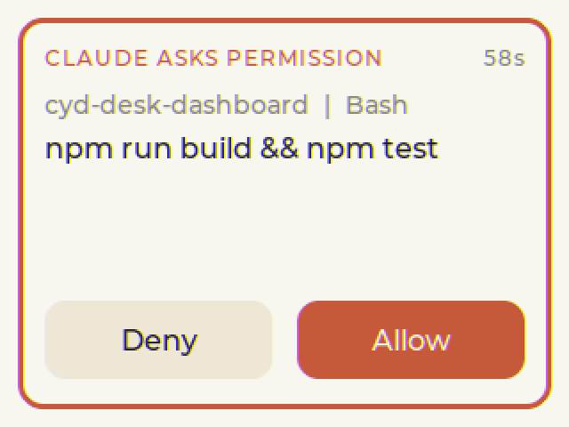

- Thẻ có đồng hồ đếm ngược 90 giây. Hết giờ, hoặc bạn quay lại máy, thì Claude Code hỏi trên máy như bình thường.
- CYD chỉ trả lời thay bạn, không bao giờ tự quyết. Luật chặn (deny rules) trong cài đặt Claude Code vẫn được áp dụng.
- Câu hỏi cần bạn nhập chữ (AskUserQuestion, duyệt kế hoạch) không gửi lên CYD.

### Ý nghĩa chấm tròn trên tab Claude
- 🟢 **Xanh lá:** số chính xác từ Anthropic.
- 🟡 **Vàng:** số ước tính từ log (chưa `claude auth login`, hoặc tạm thời không lấy được).
- 🔴 **Đỏ:** mất kết nối với server. CYD vẫn giữ số cũ để bạn xem.

### Tab Pomodoro
Bấm **−** / **+** để chỉnh thời lượng pha đang hiện (Focus / Short break / Long break), rồi bấm **Start**.
Khi hết giờ, CYD báo, kêu bíp và tự chuyển sang tab Pomodoro. Sau 4 phiên tập trung sẽ có một lần nghỉ dài.

### Chụp màn hình CYD (cho README, báo cáo)
Cắm CYD vào máy tính rồi chạy (cần `pip install pyserial pillow`):

```bash
python tools/cyd_capture.py COM8 shot man-hinh.png
```

`tour THU-MUC --gif demo.gif` chụp lần lượt mọi trang và ghép thành ảnh động; `stats` in số liệu sức khoẻ dạng JSON.

### Lệnh tắt bằng Makefile
Gõ `make` (Windows: `mingw32-make`) để xem danh sách. Hay dùng nhất:
- `make flash`: build và nạp vào CYD.
- `make stats`: RAM trống thật và thời gian vẽ.
- `make bench`: đo thời gian vẽ lại cả màn.
- `make log`: xem log Serial, ví dụ điện thoại có gọi tới trang setup không.
- `make server-restart`: khởi động lại server sau khi sửa `calendar.txt`.
- `make check`: chạy test và quét bí mật trước khi push.
- `make version V=2.0.4`: đổi số phiên bản ở mọi nơi.

Đường dẫn thư viện, cổng COM và tham số server của riêng máy bạn thì ghi vào file `local.mk` (không đưa lên GitHub), ví dụ:

```make
LIBS = D:/Arduino/libraries
PORT = COM5
SERVER_ARGS = --plan pro --reset-weekday 5 --reset-hour 2
```

---

## Xử lý sự cố

| Hiện tượng | Cách xử lý |
|---|---|
| Upload báo `Sketch too big` | Chưa chọn **Partition Scheme → Huge APP** |
| Upload đứng ở `Connecting.....` | Giữ nút **BOOT** trên bo khi đang nạp |
| Không thấy cổng COM | Thay cáp USB có truyền dữ liệu; cài driver CH340 |
| Màn trắng hoặc màu bị ngược | Chưa chép `config/User_Setup.h` vào `TFT_eSPI` |
| Lỗi biên dịch về `lv_conf.h` hoặc thiếu font | Chưa chép `config/lv_conf.h` cạnh thư mục `lvgl` |
| Điện thoại không thấy WiFi **CYD-Setup** | CYD chưa ở trang WI-FI SETUP: HOME → ⚙ → **WI-FI SETUP**. WiFi xuất hiện sau khoảng 5 giây (CYD quét WiFi nhà trước) |
| Đã vào **CYD-Setup** nhưng trang không tự mở | Mở trình duyệt, gõ **192.168.4.1**. Muốn xem CYD có nhận được yêu cầu không: mở Serial Monitor 115200, mỗi lần điện thoại gọi tới sẽ có dòng `Setup page` / `Setup redirect` |
| Không có giờ, không có thời tiết | Kiểm tra tên/mật khẩu WiFi ở trang Wi-Fi setup; CYD chỉ bắt WiFi **2,4 GHz** |
| Tab Claude báo **PC OFFLINE** | Server chưa chạy; tường lửa đang chặn (cho phép Private network); máy tính và CYD phải cùng mạng WiFi; token ở CYD phải trùng `token.txt` |
| Chấm **vàng** mãi không xanh | Chạy `claude auth login`; nếu `server.log` có `HTTP 429` thì chờ vài phút, server tự thử lại |
| Tab Account báo *needs claude auth login*, góc phải hiện `~EST` | Server tự nhờ Claude CLI gia hạn đăng nhập; nếu vẫn báo thì đăng nhập lại CLI: `claude auth login` |
| Tab Music báo *Media reader unavailable* | Chưa cài các gói `winrt-...` ở Phần 2, bước 1 |
| Không hiện thông báo khi Claude xong | Kiểm tra mục `hooks` trong `settings.json` rồi mở phiên Claude Code mới; Settings đang ở **AWAY** và bạn đang ngồi ở máy (chuyển sang **ALWAYS** để thử) |
| Thẻ duyệt quyền không hiện | Chỉ hiện khi bạn rời máy từ 1 phút trở lên và CYD đang kết nối server; kiểm tra hook `PermissionRequest` |
| Không thấy lịch hẹn | `server.log` có dòng `calendar unavailable`? Kiểm tra đường dẫn trong `calendar.txt`. Chỉ hiện sự kiện hôm nay và ngày mai |
| Chạm bị lệch, bấm nút không trúng | Thông số cảm ứng (`TOUCH_RAW_*` trong `ui_build.ino`) được đo cho một tấm cụ thể; tấm khác cần đo lại 4 góc |

---

## Cấu trúc thư mục

```
ESP32_tft_clock_weather/   firmware: file chính, net.ino (mạng), setup_portal.ino (Wi-Fi setup),
                           ui_build.ino (giao diện), ui_update.ino (cập nhật), font, icon
pc_server/                 claude_usage_server.py (server), ensure_server.py (tự bật server),
                           notify.py và permission.py (hook Claude Code), tests/ (kiểm thử)
config/                    lv_conf.h và User_Setup.h dùng cho bản build này
web/                       trang nạp firmware trên trình duyệt (GitHub Pages)
.github/workflows/         build tự động mỗi lần push; phát hành firmware khi gắn tag v*
docs/images/               ảnh cho README
tools/                     tạo font, đổi định dạng ảnh, chụp màn hình CYD qua USB
```

## Ghi công

- Ý tưởng và cấu trúc dữ liệu mức dùng Claude: [claudometer](https://github.com/krizdingus/claudometer) (MIT)
- Font [Montserrat](https://github.com/JulietaUla/Montserrat), [Fraunces](https://github.com/undercasetype/Fraunces) và [Noto Sans Thai](https://github.com/notofonts/thai) (tên bài hát tiếng Thái), giấy phép SIL OFL 1.1
- Thời tiết và chất lượng không khí: [Open-Meteo](https://open-meteo.com/)
- Nạp firmware trên trình duyệt: [ESP Web Tools](https://esphome.github.io/esp-web-tools/) (Apache 2.0)
- Icon thời tiết: từ bài hướng dẫn CYD + LVGL weather station của Random Nerd Tutorials
- Thuật toán âm lịch: Hồ Ngọc Đức

Giấy phép: [MIT](LICENSE). Các file của bên thứ ba: [THIRD_PARTY_NOTICES.md](THIRD_PARTY_NOTICES.md).
